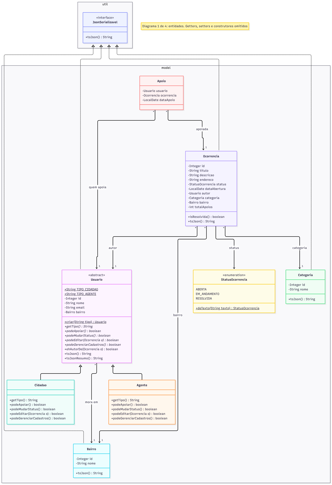
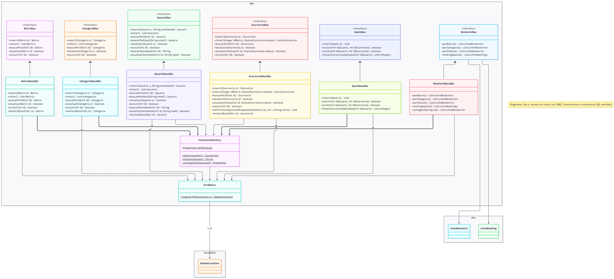
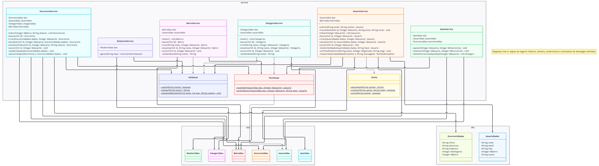
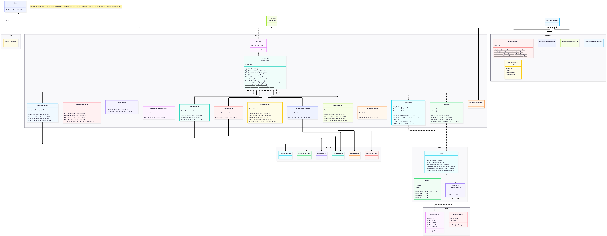
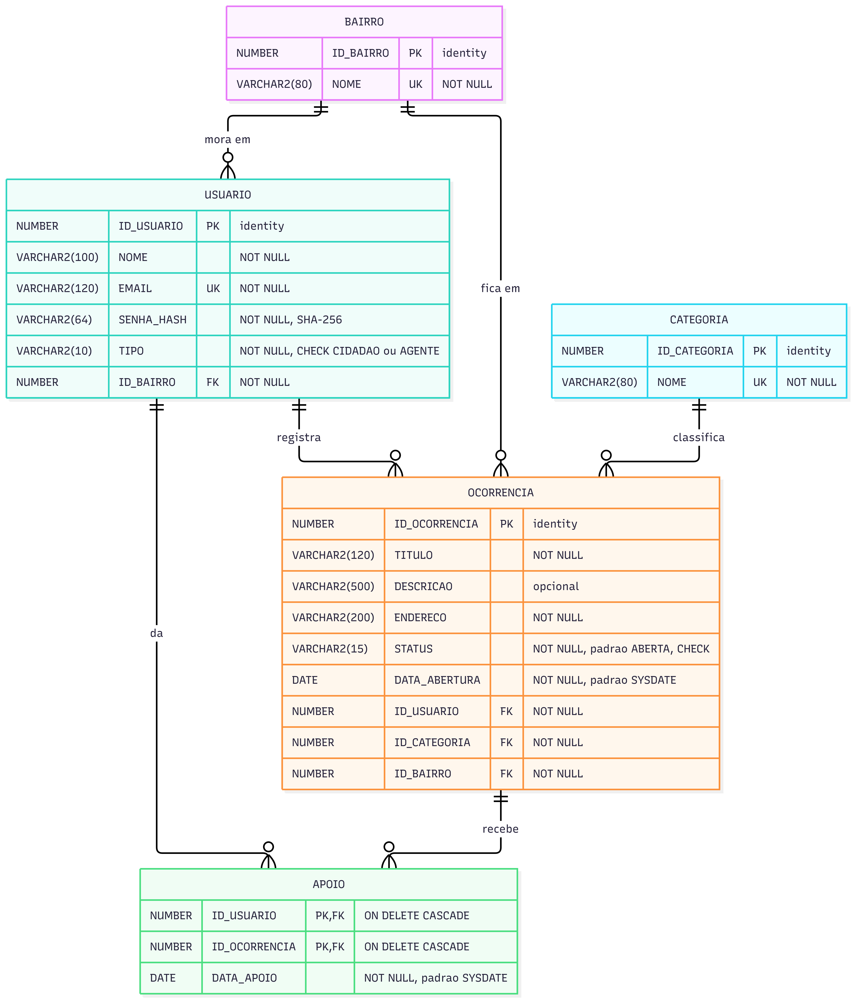

# avisa-ai
Avisa Aí: projeto comunitário, onde moradores registram e apoiam ocorrências, agentes acompanham a solução. Global Solution FIAP 2026/2 (CitizenTech).

## Proposta

- **Quem é o cidadão beneficiado:** o morador que encontra um problema no espaço público do bairro, como buraco, poste apagado, lixo acumulado ou calçada quebrada. Ele não precisa saber a quem reclamar: registra pelo site, do celular ou do computador.
- **Qual problema é resolvido:** sem um canal comum, o mesmo problema pode ser avisado várias vezes, por canais diferentes, e quem cuida da cidade não sabe o que afeta mais gente. O morador também fica sem saber se o aviso foi visto.
- **Como a solução funciona:** o morador registra a ocorrência com título, endereço, categoria e bairro. Quem viu o mesmo problema clica em "Também vi isso" em vez de abrir outro aviso. O agente vê primeiro as abertas com mais apoios e muda o status de Aberta para Em andamento e Resolvida.
- **Quais tecnologias são usadas:** back-end em Java com JDBC e banco Oracle, e front-end em HTML, CSS e JavaScript que lê e grava os dados pela API. Os detalhes estão nas seções Front-end, Back-end e Banco de dados.
- **Quem participa do ecossistema:** o morador, que registra e acompanha; os vizinhos, que confirmam o problema com o apoio; e o agente público, que prioriza, atualiza o status e cuida dos cadastros de bairros, categorias e usuários.
- **Como o impacto é medido:** a tela de Relatórios mostra quantas ocorrências já foram resolvidas, o total de ocorrências por bairro e por categoria, o total de apoios e o ranking das mais apoiadas. Assim dá para ver onde os problemas se concentram e o que ainda está pendente.

## ODS

- **ODS 11, Cidades e comunidades sustentáveis:** o projeto se liga à meta 11.3, de planejamento e gestão participativos, porque o morador passa a participar da zeladoria do bairro e o apoio dos vizinhos mostra ao poder público o que é prioridade. Também se liga à meta 11.7, de acesso a espaços públicos seguros e acessíveis, porque as ocorrências são problemas desses espaços: buraco, iluminação, lixo e sinalização.
- **ODS 10, Redução das desigualdades:** uma das categorias é "Calçada e acessibilidade". Calçada quebrada ou sem rampa pesa mais para quem usa cadeira de rodas e para idosos. Registrar e priorizar esses problemas contribui para a meta 10.2, de inclusão de todas as pessoas, independentemente de idade ou deficiência.

## Como rodar

Pré-requisitos: **JDK 17 ou mais novo** e o **SQL Developer** (ou outro cliente Oracle).

Siga esta ordem:

1. **Banco:** rode o `sql/avisa_ai.sql` no Oracle. No SQL Developer, use **F5 (Executar script)**, não Ctrl+Enter, que roda só um comando. O script pode ser rodado de novo sempre que quiser zerar os dados.
2. **Back-end:** dentro de `backend/`, configure o `db.properties` e o driver, compile e suba o servidor. O passo a passo está no [`backend/README.md`](backend/README.md). A API fica em http://localhost:8080.
3. **Front-end:** com o servidor no ar, abra o `frontend/index.html` direto no navegador.

### Contas de teste

| Conta | Tipo | Senha |
|---|---|---|
| `ana.souza@exemplo.com` | Morador | `avisa123` |
| `patricia.mendes@exemplo.com` | Agente | `avisa123` |

Todos os usuários da carga de exemplo usam a senha `avisa123`. Moradores também podem criar a própria conta na tela de login.

## Front-end

Fizemos o front com HTML, CSS e JavaScript puros

- **HTML semântico**, para o código ficar fácil de ler e funcionar bem com leitor de tela
- **CSS** com as cores do projeto definidas uma vez só em variáveis, e layout com Flexbox e Grid que se ajusta do celular ao computador
- **JavaScript** com um arquivo por página. A conversa com o back fica toda no `api.js`, e quem está logado é controlado pelo `sessao.js`
- **Fontes Barlow** salvas no projeto e **SVG**, leves e nítidas em qualquer tela
- **Bootstrap:** a janela de confirmação das exclusões e o aviso de "excluído" nas telas de Usuários e Gestão usam os componentes Modal e Toast. O Bootstrap cuida do foco dentro da janela, do Esc para fechar e da acessibilidade. Ele fica salvo no projeto (`css/bootstrap-componentes.css` e `js/vendor/bootstrap.min.js`), então funciona sem internet. Do CSS do Bootstrap, entram só as regras desses componentes, sem o reset global, para o resto do visual continuar sendo o nosso.

O front conversa com o back em `http://localhost:8080`. Se o servidor estiver desligado, as telas avisam com uma faixa no topo.

## Back-end

O back também é Java puro, sem framework. A API HTTP usa o `HttpServer` que já vem no JDK, e o JSON é montado e lido à mão, sem biblioteca

- **Camadas** com uma responsabilidade cada: `model` (entidades), `dao` (acesso ao banco), `service` (regras de negócio) e `api` (uma classe por rota). Cada camada só chama a seguinte.
- **JDBC com Oracle**: o SQL fica só no pacote `dao`, sempre com `PreparedStatement`.
- **Senha guardada como hash SHA-256**, nunca em texto, e ela não aparece em nenhuma resposta.

Detalhes, rotas e como compilar estão no [`backend/README.md`](backend/README.md).

## Banco de dados

São 5 tabelas no Oracle:

| Tabela | O que guarda |
|---|---|
| `BAIRRO` | os bairros da cidade |
| `CATEGORIA` | os tipos de problema (buraco, iluminação, lixo...) |
| `USUARIO` | moradores e agentes, com e-mail, hash da senha e bairro |
| `OCORRENCIA` | os avisos, com autor, categoria, bairro, status e data |
| `APOIO` | quem apoiou qual ocorrência |

Usuário e ocorrência têm um relacionamento **N:N** pela tabela `APOIO`: um morador apoia várias ocorrências, e uma ocorrência recebe apoio de vários moradores. A chave primária é o par (usuário, ocorrência), então ninguém apoia a mesma ocorrência duas vezes.

- [`sql/avisa_ai.sql`](sql/avisa_ai.sql): cria as tabelas e as restrições e insere a carga de exemplo. Pode ser rodado de novo para zerar os dados.
- [`sql/relatorios.sql`](sql/relatorios.sql): as 4 consultas dos relatórios (por bairro, por categoria, por status e ranking dos mais apoiados).

## Estrutura de pastas

avisa-ai/
├── frontend/            páginas HTML, css/, js/, img/ e fonts/
├── backend/
│   ├── src/br/com/avisaai/   código Java: model, dto, dao, service, api, exception, util
│   ├── lib/             driver do Oracle (ojdbc17.jar)
│   ├── db.properties.example   modelo das credenciais do banco
│   └── README.md        como compilar e rodar, e as rotas da API
├── sql/                 avisa_ai.sql (tabelas e carga) e relatorios.sql (consultas)
├── docs/                documentação e diagramas
└── README.md

## Diagramas

### Diagrama de classes

Dividido em 4 partes para ficar legível. Cada parte diz no topo o que foi omitido (getters, setters e construtores). A versão com todas as classes e todos os métodos está em [`docs/diagrama-classes-completo.png`](docs/diagrama-classes-completo.png).

**1. Entidades (`model`)**

**2. Acesso ao banco (`dao`)**

**3. Regras de negócio (`service`)**

**4. API, exceções e utilitários (`api`, `exception`, `util`)**

### Diagrama entidade-relacionamento

## Segurança

> O back confia no parâmetro `?usuario` enviado pelo front para saber quem está agindo. Num sistema real, usaríamos um token de sessão gerado pelo servidor no login.
>
> As senhas são guardadas com hash SHA-256, sem salt, então senhas iguais geram o mesmo hash. Num sistema real, usaríamos PBKDF2 com salt (`PBKDF2WithHmacSHA256`, que já vem no Java).
>
> Cada requisição abre uma conexão nova com o Oracle. Num sistema real, usaríamos um pool de conexões.

## Créditos

O projeto usa três recursos de terceiros, todos com licença que permite o uso:

| Recurso | Onde está | Licença |
|---|---|---|
| [Bootstrap 5.3.3](https://getbootstrap.com/) | `frontend/css/bootstrap-componentes.css` e `frontend/js/vendor/bootstrap.min.js`, só os componentes Modal e Toast | MIT |
| Fontes [Barlow e Barlow Condensed](https://fonts.google.com/specimen/Barlow), de Jeremy Tran | `frontend/fonts/` | SIL Open Font License 1.1 |
| [Driver Oracle JDBC (ojdbc17)](https://www.oracle.com/database/technologies/appdev/jdbc-downloads.html) | `backend/lib/ojdbc17.jar` | Oracle Free Use Terms and Conditions |

## Integrantes

| Nome | RM |
|---|---|
| CRISTIAN REZENDE DE ALMEIDA | RM566344 |
| FELIPE VIEIRA ESPINDOLA | RM562840 |
| LETÍCIA SANTANA PEIXOTO GASPARI | RM566000 |
| LUCAS LEITE TEGNER | RM564763 |
| MARINA ARAUJO T MUNIZ TRINDADE | RM561971 |

## Vídeo pitch

Link: 
